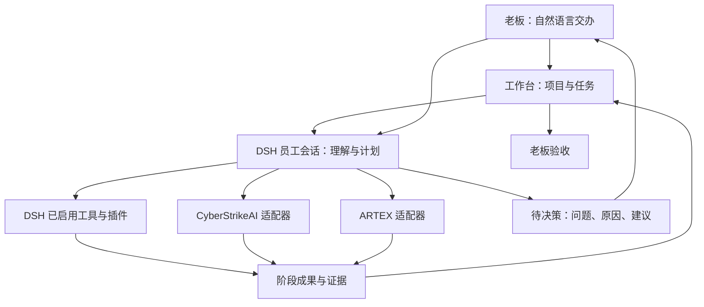

# dsh-workbench · DSH 项目工作台

把一句交办变成可跟踪的工作：老板描述目标，DSH 员工理解任务、使用工具、阶段汇报，遇到必要决策再来请示。

**当前版本：0.1.0-alpha.4，开发原型。** 已实现原生插件入口、侧边栏主面板、任务状态持久化、7 个模型工具、阶段回报、人工决策与验收，以及 CyberStrikeAI / ARTEX 适配器。已在本机 DSH 桌面完成工作台交办、模型阶段汇报、人工问答和申请验收测试，Kali 两个平台的服务可达性也已检查。尚未执行真实业务派工或生产项目验收。

## 核心体验

1. 首页只保留对话输入框、项目选择和新对话/历史/设置入口。在“设置 → 项目与目录”添加项目时选择“使用已有文件夹”或“在指定路径新建文件夹”，可用原生目录选择器。没有选择项目的任务进入 DSH 默认工作区；指定项目的任务进入对应原生工作区。
2. 在首页输入要求后点击“交给员工”，通过 DSH 原生 `session.create/prompt` 创建独立员工会话，继承宿主默认模型和 Agent 预设。
3. 员工查阅资料，将目标、约束、假设、阶段和完成标准记录成任务契约，使用当前会话已有的 Skills、MCP、文件及其他工具。
4. 每完成一个阶段，回报“做了什么、还缺什么、证据在哪里”。工作台定期刷新这些持久记录。
5. 有必要由老板决定时，提出问题、原因、选项和员工建议。只阻塞相关阶段；老板答复后通过原生会话继续执行。
6. 员工申请验收，老板查看证据后验收通过。

分词使用 `Intl.Segmenter` 提供术语和项目别名检索提示。**真正的意图判断由 DSH 当前模型完成，结构校验和任务状态由代码负责。** 不使用关键词或模型自报置信度来授予权限。



## 开发与验证

需要 Node.js 22 或更高。无生产依赖下载，DSH 的 peer 包由宿主提供；React 开发依赖用于离线渲染检查。

```sh
npm ci --ignore-scripts --legacy-peer-deps
npm run build
npm test
```

用已安装 DSH 的真实工具定义器做接口兼容检查：

```sh
DSH_RUNTIME_ROOT='/path/to/dsh-runtime' npm run check:host
```

该目录须包含 DSH runtime 的 `package.json` 和 `node_modules/@deepseek-ai`。此检查不启动模型、不启动虚拟机、不执行安全测试，也不修改现有 DSH profile。当前声明兼容 **DSH 0.2.2-rc.1 / Cordis 4.1.x**；其他版本需要重新验证。

## 安装到开发 profile

先完成构建，再通过 DSH 插件管理器安装本地链接包；CLI 示例：

```sh
dsh plugin --profile <development-profile> add link:/absolute/path/to/dsh-workbench
```

应用内置发行版不一定将 `dsh` 加入 PATH，应使用该发行版的插件管理界面或实际 CLI 入口。插件修改作用于所选 profile。首次验收建议使用独立 profile，避免影响正在进行的任务。

启用后，侧边栏应出现“项目工作台”。数据默认存放于 `$DSH_HOME/workbench/state.json`，没有 `DSH_HOME` 时使用 `~/.dsh/workbench/state.json`。多个 profile 必须配置不同 `dataFile`，因为同一状态文件仅允许一个写入者。

异常退出会保留 `state.json.lock/owner.json`。先确认记录的进程已退出，备份数据并核实远端运行状态，再移除该锁目录；禁止盲目删除活进程的锁。重启恢复台账，不自动重放已派发的工作。

## Kali 执行端

参见 [配置示例](docs/config.example.json) 和 [接口核对](docs/compatibility.md)。普通 HTTP 适配器使用宿主环境变量中的令牌；Kali 自动连接模式使用 Parallels guest 通道和 DSH 凭据存储，界面登录后只保存会话令牌，不保存密码。示例不含真实凭据。

- **CyberStrikeAI**：读取绑定项目和异步执行状态；通过 `/api/eino-agent/runs` 提交任务，使用 `Idempotency-Key`。
- **ARTEX**：绑定一个已有任务，读取任务和主 Agent 状态，通过 `/api/chat?task=...` 发送工作指令。初版不自动创建 ARTEX 任务，因为当前平台创建接口会直接启动工作。
- 每个工作台项目显式映射远端项目/任务，可在连接面板保存绑定。派工范围可在任务卡中由用户填写，默认有效期 24 小时，也兼容宿主预配置；模型工具不能修改授权。
- 初版的“暂停 DSH 员工”只取消 DSH 会话。外部平台已接受的工作需在平台停止，回到工作台核实；ARTEX 主对话、Planner/Worker 的生命周期不相同。
- 网络异常后保持“结果未知”。初版要求人工核实外部结果后才能验收，避免把“已接受”或“主对话空闲”当作完成。后续自动对账需要增加平台级事件与回执绑定。

工作台提供任务组织与委派记录，不是 DSH 工具的独立安全沙箱。原生工具权限由 DSH 预设及平台控制；本地全权限模型拥有与宿主用户相同的文件访问能力。任务授权文字不能替代执行端的范围控制。

## 文件结构

| 文件 | 职责 |
|---|---|
| `lib/core.js` | 持久化事务、项目、任务、阶段、决策与验收 |
| `lib/index.js` | Cordis 插件与 7 个 DSH 工具 |
| `lib/panel.js` / `lib/client.js` | React 主面板与生成的 DSH 客户端模块 |
| `lib/connectors.js` | 执行端绑定、派工回执、幂等和人工核实 |
| `lib/http.js` | 本机工作台界面的 API |
| `lib/prompts.js` | 员工协议和任务上下文 |
| `test/` | 状态、恢复、隔离、幂等及界面渲染验证 |

更多设计和后续路线见 [架构设计](docs/architecture.md)。

## Kali 自动连接

在 `workbench` 配置行加入 `kali: { enabled: true, vm: "Kali" }`。guest 内安装 `scripts/kali-bridge.py` 到 `/opt/dsh-workbench/bridge.py`，目录与程序权限 0755。示例启动单元见 `deployment/`，其路径和用户需按实际环境调整。

面板每 15 秒检查运行中的 Kali；不自动启动虚拟机。Kali 开机由 systemd 启动两个平台，ARTEX 的 Docker restart policy 负责容器故障恢复。主机通过已认证的 Parallels guest 通道读写 guest 回环 API，不依赖桥接 IP；CyberStrikeAI 的自签证书通过 guest 本地通道取得并用于该次 TLS 验证。桥接程序仅接受列出的平台 API，不提供任意 shell 或 URL 转发。

工作台登录后显示“已连接 · 登录有效”。平台令牌到期时需要再次登录。绑定已有远端项目并设置任务范围后，员工才能派工；服务在线和认证成功本身不会启动业务测试。

## 简洁对话界面

- 首页：描述工作并直接交给员工；不选项目时使用默认工作区。
- 历史：打开已有任务，查看按时间排列的阶段汇报、补充要求、决策和交付。
- 设置 → 项目与目录：选择现有目录，或在指定路径创建独立文件夹。
- 设置 → Kali 连接：服务状态、登录、Mac 项目与远端任务/项目的关联。关联不等于文件共享或同步。
- 设置 → 当前任务设置：为当前任务记录远端执行范围。

真实桌面已验证两平台登录成功；登录令牌由 DSH 凭据存储保管。Kali 两个 systemd 单元均为 enabled/active，ARTEX 容器在启动单元验证前后保持相同 ID，未为验证重启业务容器。未实际重启 Kali，也未向平台提交业务任务。
