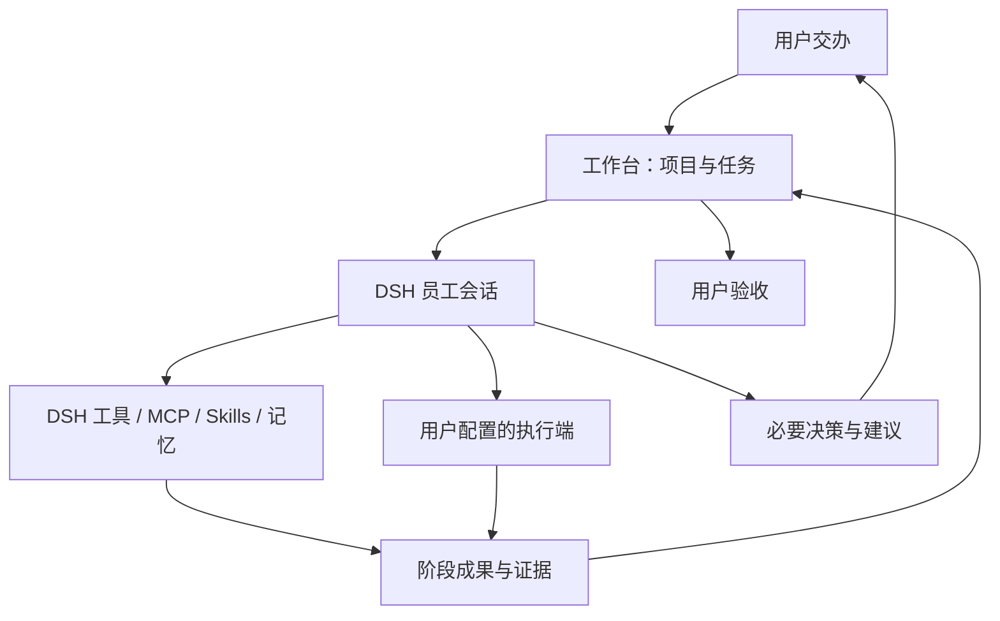

# dsh-workbench · DSH 项目工作台

在 DSH 里用一句话交办工作，让模型员工理解目标、调用已有工具、分阶段回报，并在需要时向你请示。

**0.1.0-alpha.7 · 开发预览。** 首页保持对话式界面，配置放在二级设置页。新安装的执行端列表为空：不包含任何人的虚拟机名称、账户、令牌、项目 ID 或项目路径，也不会自动启动 VM、安装服务或派发任务。

## 使用

- **首页**：描述要求后点击“交给员工”。不选项目时使用 DSH 默认工作区；选择项目时使用对应目录和原生工作区。
- **历史**：查看阶段汇报、证据、补充要求、决策和交付。
- **设置 → 项目与目录**：选择已有目录或新建目录。未手动填写项目名时自动使用最后一层文件夹名称。
- **设置 → 工具接入**：添加自己的 HTTP/JSON 服务，或选择 ARTEX / CyberStrikeAI API 适配器。DSH 已启用的工具、Skills、MCP 和记忆按当前员工会话权限复用。
- **设置 → 当前任务设置**：填写外部执行范围。关联项目只记录任务归属，不挂载或同步文件夹。

## 自定义工具

在“工具接入”中填写连接 ID、显示名称、服务 origin、认证方式，以及状态/提交接口。`http-json` 适配器支持 GET 状态接口、POST JSON 任务提交、可选执行状态查询和请求体模板；它面向任务执行端，不是任意 REST 协议的自动推断器。

模型通过 `workbench_connector_list` 发现用户已配置的连接 ID，再使用状态或提交工具。连接配置与令牌的保存操作只出现在用户设置接口，不作为模型工具开放。

- 新连接默认没有地址或凭据，保存不会自动访问接口。
- 连接测试只在用户点击时调用所配置的只读测试路径。
- 请求模板仅替换声明的变量，不运行 JavaScript 或 shell。
- 令牌通过 DSH 凭据存储或环境引用读取，单独保管；连接配置不保存令牌值。
- 修改连接后，原任务的执行授权需要重新设置；尚有未知或未核实执行回执时拒绝修改连接。
- 任意本地命令和原生 MCP 的接入继续使用 DSH 自身的工具配置，不另开一条绕过 DSH 权限的执行通道。

详见 [自定义工具协议](docs/custom-tools.md)。

## 项目归档与恢复

在“项目与目录”的项目列表中可归档、删除或恢复整个项目。执行前会展示原路径、DSH 会话数和工作台任务数。

- **归档**：归档对应 DSH 工作区中的会话，收起工作区登记，将工作台项目移入“已归档”。
- **删除**：移除登记并放入工作台回收站；保留任务记录、DSH 会话日志和磁盘文件，可以恢复。
- **恢复**：重新登记原目录并恢复关联会话，不移动项目文件。
- DSH 默认工作区的登记受到保护；可以归档会话，但不能删除默认登记。
- 活动会话或未核实的外部执行会阻止归档；不会强行停止员工或远端平台任务。
- 直接在 DSH 归档全部会话或移除工作区时，工作台显示状态不同步提醒，等待用户处理。
- 部分操作失败会保留错误和恢复快照，不把部分完成报告为已同步。

详见 [项目生命周期](docs/project-lifecycle.md)。

## DSH 原生能力复用

员工由 DSH `session.create/prompt` 创建，继承宿主模型与 Agent 预设。分词只提供术语检索提示；真正的意图理解由模型完成，任务契约和状态由代码校验。



当前有 8 个模型工具：读取任务、提交计划、阶段回报、请示、申请验收、发现执行端、查询状态和派工。员工提供的证据仍需核实；它不能代替用户验收。

## 可选 Kali 连接

Kali 是可选适配方案，不是安装前提。发布包的默认配置是 `{}`；[配置模板](docs/config.example.json) 也禁用 Kali 并留空机器字段。使用者需要自行配置虚拟机、guest 用户、桥接路径和平台端口。

桥接程序与 systemd 示例仅供显式部署，安装插件不会运行它们。模板中的路径和用户必须替换；参见 [Kali 配置](docs/kali-setup.md)。已配置本地 Kali 的用户可以保留自己的宿主配置和 DSH 凭据，不必把配置写进插件源码。

## 开发与安装

Node.js 22 或更高，DSH peer 包由宿主提供。当前核对版本为 DSH `0.2.2-rc.1` / Cordis `4.1.x`。

```sh
npm ci --ignore-scripts --legacy-peer-deps
npm run build
npm test
DSH_RUNTIME_ROOT='/path/to/dsh-runtime' npm run check:host
```

在 DSH 插件管理器中安装本地包，或在开发 profile 使用：

```sh
dsh plugin --profile <development-profile> add link:/absolute/path/to/dsh-workbench
```

桌面发行版不一定将 `dsh` 加入 PATH，应使用发行版的插件管理界面或实际 CLI 入口。

状态、项目和用户填写的连接定义保存在 `$DSH_HOME/workbench/state.json`，未设置 `DSH_HOME` 时使用 `~/.dsh/workbench/state.json`。凭据由 DSH 自己的凭据提供方保存。这些运行数据都不属于 GitHub 源码或发布包。多个 profile 应使用不同 `dataFile`。

异常退出可能留下 `state.json.lock/owner.json`。确认该进程已退出、备份数据并核实远端状态后再移除锁目录。重启恢复台账，不自动重放派工。

## 验证边界

测试覆盖任务状态、同目录识别、项目归档与恢复、部分失败、通用 HTTP 模板、凭据隔离和重复派工。本机曾完成 DSH 原生交办、模型汇报、人工答复与验收，以及可选 Kali 平台登录；没有用生产目标做派工测试。Kali 整机重启恢复和生产项目交付尚未验收。

原生 DSH 工具权限与远端范围控制仍由各自系统承担。工作台提供组织与追踪能力，不是独立的安全沙箱。

[架构设计](docs/architecture.md) · [接口兼容性](docs/compatibility.md)

## 模型与智能体模式

新任务输入框下可选择 DSH 智能体模式、模型，以及该模型支持的推理等级，默认跟随 DSH 当前设置。目录从宿主实时读取，新增或调整 DSH 模型后可点击“刷新模型”。不另存模型账户或 API Key。

所选模式随原生会话创建请求传入，模型选择通过 DSH 的 AgentModel 在首次派工前应用，仅影响该员工会话，不修改全局默认模型。选择随任务保存，已开始的任务显示启动配置；模式和模型选择入口用于新任务。远端 ARTEX、CyberStrikeAI 或自定义执行端继续使用各自的模型配置。

若模式损坏、模型下架或推理等级不支持，会在派工前报错，不自动改用另一个模型。

模式菜单使用 DSH 原生 `Menu` 组件及 `settings.agentPreset` 翻译，已有自定义模式保留自己的名称与说明。模型和模式数据始终来自宿主目录；中文名称仅是显示层，不会新增或伪造模式。对话框使用 DSH 主题 token，项目/模式置于上方，模型/推理与发送置于底部，框体样式不依赖菜单开合。
