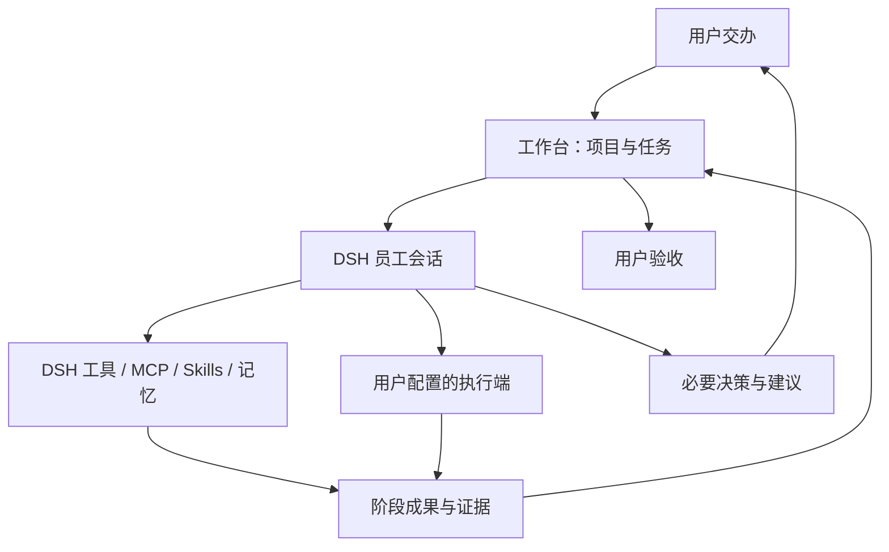

# dsh-workbench · DSH 项目工作台

在 DSH 里用一句话交办工作，让模型员工理解目标、调用已有工具、分阶段回报，并在需要时向你请示。

**0.1.0-alpha.16 · 开发预览。** 首页保持对话式界面，配置放在二级设置页。新安装的执行端列表为空：不包含任何人的虚拟机名称、账户、令牌、项目 ID 或项目路径，也不会自动启动 VM、安装服务或派发任务。

## 使用

- **首页**：描述要求后点击“交给员工”。不选项目时使用 DSH 默认工作区；选择项目时使用对应目录和原生工作区。
- **历史**：查看阶段汇报、证据、补充要求、决策和交付。
- **设置 → 项目与目录**：选择已有目录或新建目录。未手动填写项目名时自动使用最后一层文件夹名称。
- **设置 → 工具接入**：添加自己的 HTTP/JSON 服务，或选择 ARTEX / CyberStrikeAI API 适配器。DSH 已启用的工具、Skills、MCP 和记忆按当前员工会话权限复用。
- **设置 → 当前任务设置**：填写外部执行范围。关联项目只记录任务归属，不挂载或同步文件夹。

## 自定义工具

在“工具接入”中填写连接 ID、显示名称、服务 origin、认证方式，以及状态/提交接口。`http-json` 适配器支持 GET 状态接口、POST JSON 任务提交、可选执行状态查询和请求体模板；它面向任务执行端，不是任意 REST 协议的自动推断器。

模型通过 `workbench_connector_list` 发现用户已配置的连接 ID，再使用状态或提交工具。连接配置与令牌的保存操作只出现在用户设置接口，不作为模型工具开放。

- 新连接默认没有地址或凭据，保存不会自动访问接口。
- 连接测试只在用户点击时调用所配置的只读测试路径。
- 请求模板仅替换声明的变量，不运行 JavaScript 或 shell。
- 令牌通过 DSH 凭据存储或环境引用读取，单独保管；连接配置不保存令牌值。
- 修改连接后，原任务的执行授权需要重新设置；尚有未知或未核实执行回执时拒绝修改连接。
- 任意本地命令和原生 MCP 的接入继续使用 DSH 自身的工具配置，不另开一条绕过 DSH 权限的执行通道。

详见 [自定义工具协议](docs/custom-tools.md)。

## 项目归档与恢复

在“项目与目录”的项目列表中可归档、删除或恢复整个项目。执行前会展示原路径、DSH 会话数和工作台任务数。

- **归档**：归档对应 DSH 工作区中的会话，收起工作区登记，将工作台项目移入“已归档”。
- **删除**：移除登记并放入工作台回收站；保留任务记录、DSH 会话日志和磁盘文件，可以恢复。
- **恢复**：重新登记原目录并恢复关联会话，不移动项目文件。
- DSH 默认工作区的登记受到保护；可以归档会话，但不能删除默认登记。
- 活动会话或未核实的外部执行会阻止归档；不会强行停止员工或远端平台任务。
- 直接在 DSH 归档全部会话或移除工作区时，工作台显示状态不同步提醒，等待用户处理。
- 部分操作失败会保留错误和恢复快照，不把部分完成报告为已同步。

详见 [项目生命周期](docs/project-lifecycle.md)。

## DSH 原生能力复用

员工由 DSH `session.create/prompt` 创建，继承宿主模型与 Agent 预设。分词只提供术语检索提示；真正的意图理解由模型完成，任务契约和状态由代码校验。



基础任务提供 11 个模型工具：读取任务、提交计划、阶段回报、请示、申请验收、发现执行端、查询状态、派工、登记交付文件、重试落盘和生成连接配置建议。员工提供的证据仍需核实；它不能代替用户验收。

## 可选 Kali 连接

Kali 是可选适配方案，不是安装前提。发布包的默认配置是 `{}`；[配置模板](docs/config.example.json) 也禁用 Kali 并留空机器字段。使用者需要自行配置虚拟机、guest 用户、桥接路径和平台端口。

桥接程序与 systemd 示例仅供显式部署，安装插件不会运行它们。模板中的路径和用户必须替换；参见 [Kali 配置](docs/kali-setup.md)。已配置本地 Kali 的用户可以保留自己的宿主配置和 DSH 凭据，不必把配置写进插件源码。

## 开发与安装

Node.js 22 或更高，DSH peer 包由宿主提供。当前核对版本为 DSH `0.2.2-rc.1` / Cordis `4.1.x`。

```sh
npm ci --ignore-scripts --legacy-peer-deps
npm run build
npm test
DSH_RUNTIME_ROOT='/path/to/dsh-runtime' npm run check:host
```

在 DSH 插件管理器中安装本地包，或在开发 profile 使用：

```sh
dsh plugin --profile <development-profile> add link:/absolute/path/to/dsh-workbench
```

桌面发行版不一定将 `dsh` 加入 PATH，应使用发行版的插件管理界面或实际 CLI 入口。

状态、项目和用户填写的连接定义保存在 `$DSH_HOME/workbench/state.json`，未设置 `DSH_HOME` 时使用 `~/.dsh/workbench/state.json`。凭据由 DSH 自己的凭据提供方保存。这些运行数据都不属于 GitHub 源码或发布包。多个 profile 应使用不同 `dataFile`。

异常退出可能留下 `state.json.lock/owner.json`。确认该进程已退出、备份数据并核实远端状态后再移除锁目录。重启恢复台账，不自动重放派工。

## 验证边界

测试覆盖任务状态、同目录识别、项目归档与恢复、部分失败、通用 HTTP 模板、凭据隔离和重复派工。本机曾完成 DSH 原生交办、模型汇报、人工答复与验收，以及可选 Kali 平台登录；没有用生产目标做派工测试。Kali 整机重启恢复和生产项目交付尚未验收。

原生 DSH 工具权限与远端范围控制仍由各自系统承担。工作台提供组织与追踪能力，不是独立的安全沙箱。

[架构设计](docs/architecture.md) · [接口兼容性](docs/compatibility.md)

## 模型与智能体模式

新任务输入框下可选择 DSH 智能体模式、模型，以及该模型支持的推理等级，默认跟随 DSH 当前设置。目录从宿主实时读取，新增或调整 DSH 模型后可点击“刷新模型”。不另存模型账户或 API Key。

所选模式随原生会话创建请求传入，模型选择通过 DSH 的 AgentModel 在首次派工前应用，仅影响该员工会话，不修改全局默认模型。选择随任务保存，已开始的任务显示启动配置；模式和模型选择入口用于新任务。远端 ARTEX、CyberStrikeAI 或自定义执行端继续使用各自的模型配置。

若模式损坏、模型下架或推理等级不支持，会在派工前报错，不自动改用另一个模型。

模式菜单使用 DSH 原生 `Menu` 组件及 `settings.agentPreset` 翻译，已有自定义模式保留自己的名称与说明。模型和模式数据始终来自宿主目录；中文名称仅是显示层，不会新增或伪造模式。对话框使用 DSH 主题 token，项目/模式置于上方，模型/推理与发送置于底部，框体样式不依赖菜单开合。

## 本机项目是成果主存储

工作区留在用户指定的本机目录；在 Mac 部署中就是 Mac 项目目录。Kali、ARTEX、CyberStrikeAI 或自定义服务只作为执行工具，按需交接材料和成果，不做整个工作区的双向同步。

新任务及后续进展自动保存到：

```text
<项目目录>/工作台产出/<任务 ID>/
  manifest.json          当前成果索引
  任务记录-<摘要>.json    任务、阶段、决策与回执记录
  返回数据/              工作台连接器返回的完整 JSON
  报告/                  版本化阶段汇报与最终 Markdown 报告
```

工作台自动归档通过连接器返回的数据及阶段/交付报告。DSH 原生工具生成的 Word、PDF、截图、CSV 等文件，由员工放到该项目目录后通过 `workbench_output_register` 登记路径、大小和 SHA-256。正文、回执和索引保留在本机；工具接入的认证头和连接登录凭据不会由工作台主动导出。

远端仅返回文件路径或链接时，必交文件先登记为 `remote`，再由已有 DSH 工具按需导出/取回。取回后登记 `local` 并带上同一 `sourceReference`。工作台验证本地路径与实际文件哈希；没有取回的必交文件不能验收。它不会因为保存了返回 JSON，就把其中的远端 PDF 链接显示成已经下载的 PDF。

任务详情可打开成果目录、定位报告或重试保存；历史任务可以一键补存。目录不可写或成果文件变化时会明确报错。远端已经接单后，即使本地保存失败，也保留原回执与待保存数据，不把它当作需要重新派工。

生成的报告与记录使用内容版本文件名，既有生成文件被人工修改时不会覆盖；需要保留人工修订版，可将其作为本地交付文件重新登记。项目自己的 Git 规则决定是否追踪这些产物，插件不会自动上传它们。详见 [成果归档规则](docs/project-outputs.md)。

### alpha.10 使用变化

- 首页参考 DSH 原生对话布局；模型菜单含“模型 / 思考强度”，跟随默认模型时也可选择强度，仅作用于本次任务。
- 工作区下拉显示现有 DSH 工作区，并提供“添加工作区…”。选择现有目录后在工作台登记，归档项目需要先恢复。
- 员工实际执行状态、可见正文、工具名称和原生待审批状态显示在对话中；“当前轮已结束”不代表任务已完成。
- ARTEX / CyberStrikeAI 可读取已有远端任务/项目列表并分页选择，仍保留手工 ID 入口。
- 已派发的 CyberStrikeAI 独立回执自动跟踪，结果落盘后通知员工整理汇报。ARTEX 自动观察状态，结果仍需核实。当前不通过平台的共享任务停止接口自动取消远端运行。
- 断线按退避间隔重查，不重复提交；暂停期间继续回收已有结果，但不自动唤醒员工。
- 客户端按游标读取变更，历史按批展示；重复返回内容、无变化状态和成果索引不会反复写盘。流式文字只保存在内存，结束后的正文最多保留最近 100 条供工作台展示，完整记录仍在 DSH 会话。

“老板 → 主管 → 专员与工具 → 验收 → 继续分派或交付”的实现边界与参考项目见 [主管与专员架构方案](docs/supervisor-design.md)。alpha.12 已实现独立工作单调度器与主管验收循环，具体边界见该文档。

也可以在工作台对话里要求 AI 新增或编辑连接：提供服务地址和接口说明，AI 使用 `workbench_connection_propose` 生成配置卡片，你核对后点击“确认保存连接”。明文凭据不进入建议；宿主管理的连接仍在宿主配置管理。此操作仅保存连接，不自动建立业务项目关联或授权派工。

### alpha.12 主管与专员

新任务由主管理解需求、计划与派工。专员使用 DSH 原生 spawn 独立上下文执行工作单，回报证据和本机文件；主管逐项验收，未达标在预算内返工。工作单与各版回报、验收记录在对话中可见，并写入 Mac 项目报告。

当前固定限制：全局最多 2 个专员同时执行，每任务最多 12 张工作单、24 次专员启动，每单最多 2 次返工，每次专员运行最多 40 次允许工具调用、20 分钟后请求停止。工具守卫限制工作单工具范围与继续委派；这不是文件系统或网络沙箱，也不替代 DSH 原有权限。没有硬 token/费用预算。

重启只核对已有专员；原运行已中断时，由主管基于已有记录决定重派。启动结果无法核实时须人工记录核实结果，运行中的原专员不能放行重派。暂停同时停止新派工并向本任务主管/专员请求停止，远端平台已接受的工作沿用原有回执跟踪与核实机制。

增加 8 个团队工具：能力目录、派工、验收、重派、专员读取/回报、专员执行端查询/派工。主任务阶段只能在关联工作单全部通过验收后标为完成；老板保留最终验收。

### alpha.16 历史任务整理

历史页增加“最近任务 / 已归档 / 回收站”。每项任务可以单独归档、移入回收站和恢复，对应 DSH 主会话同步归档/恢复；文件、报告和会话记录不永久删除。

项目归档或删除后，任务自动归入对应分类；恢复项目时，单独归档或删除过的任务保持原位置。删除前已经归档的任务，先恢复到已归档分类，再可取消归档。未完成任务恢复后保持暂停，需要明确继续；正在运行的会话/专员、未核实的远端运行会阻止整理操作。

### 图片输入

输入框支持粘贴、拖入和选择 PNG / JPEG / WebP / GIF 图片，发送前可预览或移除，也可以只发送图片。图片通过 DSH 原生上传与消息附件能力发送，不把文件路径当作图片内容；格式、数量、大小与模型图像能力由 DSH 检查。

发送的图片经 DSH 规整后，保存到当前 Mac 项目的 `工作台产出/<任务ID>/输入图片/`，历史对话可查看缩略图，主管可把本机路径交给专员。上传或发送失败时保留当前草稿，重试使用同一消息标识；如果图片尚未全部保存，重新打开后会要求补齐图片，不静默丢图。模型不支持图像时会显示宿主错误，需要选择支持图片的模型。
