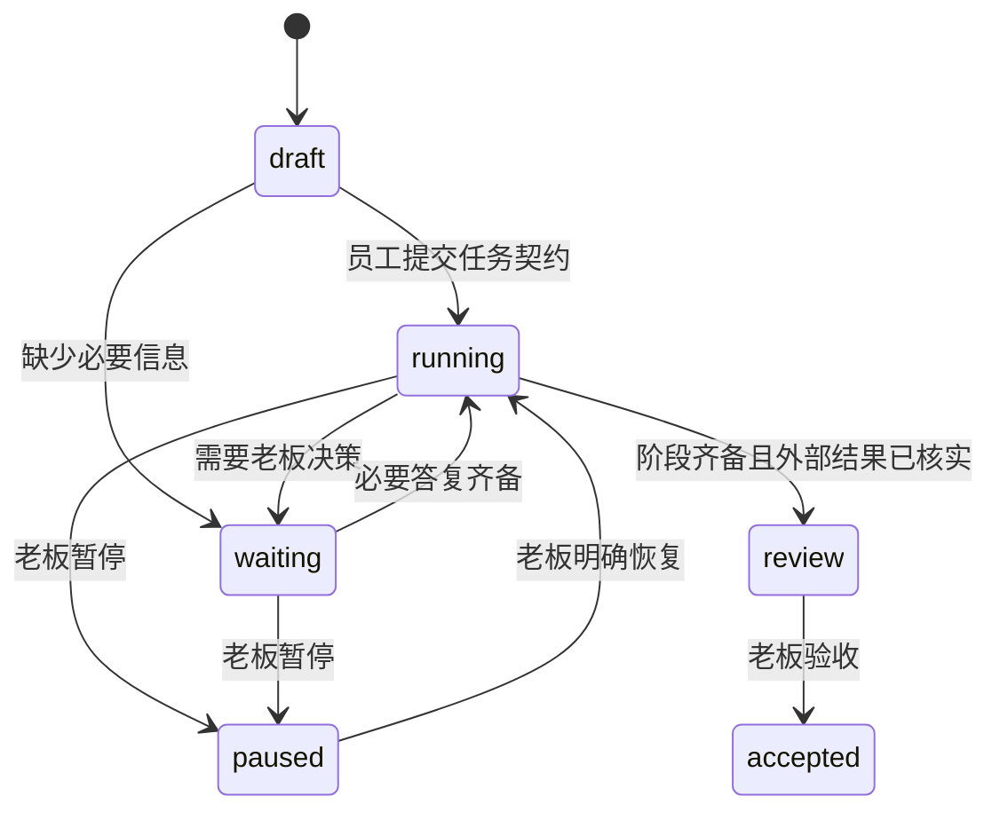

# 通用工作台设计

## 产品边界

工作台统筹多个项目，安全测试只是专业工作之一；同样支持代码开发、文档整理、资料分析、运维和报告。每个项目保存工作目录、别名、远端映射；每项交办有独立任务 ID、原始描述和员工会话。

“老板”和“员工”是交互关系。老板拥有目标和重要决策，员工负责理解、计划、执行与回报。第一版用一个 DSH 员工会话负责一项任务；DSH 已有的子 Agent 可以在其内部承担明确子任务并向父会话回报。平台内部已经具备 Agent 时，按可追踪的专业服务委派，不重复建设另一套工具执行循环。

## 模糊指令如何处理

处理链路为：项目上下文检索 → 术语/别名识别 → LLM 语义抽取 → 字段校验 → 澄清或执行。分词只是检索的辅助环节。

任务契约包含原话、项目、目标、约束、假设、阶段与验收标准。后续版本增加交付格式、成本上限、截止时间、阶段依赖及可版本化的范围变更。

| 情况 | 员工应做什么 |
|---|---|
| “把这个项目梳理一下”且已选项目 | 先读取项目资料，给出带来源的现状及下一步建议 |
| “那个银行项目”对应多个候选 | 请老板明确项目，不能靠置信度猜测 |
| 格式未指定但目标明确 | 使用合理默认格式，说明假设后继续 |
| 目标互相冲突 | 列出冲突与具体选项，请老板确定优先级 |
| 某阶段缺资料 | 只阻塞该阶段，独立阶段继续 |
| 新动作超出既定范围 | 先形成具体变更建议，再请求老板决策 |
| 平台返回“accepted” | 保存回执，继续核实执行状态，不报告任务完成 |

这些是产品规则和待评测用例，当前没有对真实模型运行准确率评测，不能据此声明意图识别成功率。

## 状态与汇报

`waiting` 可以包含仍可继续的独立阶段。决策记录保留问题、阻塞阶段、原因、选项、建议、答复、答复投递 ID 和是否已投递。投递失败可重试同一请求；超时或没有答复都不代表批准。

阶段报告包括：完成事实、未完成清单、证据引用和时间。完成阶段必须有引用，但引用本身仅标为 `reported-by-agent`；当前不自动校验本地文件内容、外部证据真实性或交付质量。

## 复用 DSH

| 已核对接口 | 工作台用途 |
|---|---|
| Cordis bundle patch / `apply(ctx)` | 插件装配和生命周期 |
| `slots` 的 `main`、`sidebar.panellist` | 独立原生工作台面板 |
| `remote.session.create/prompt/cancel` | 员工会话、发指令和取消当前轮 |
| `uiWorkspace.openSession` | 打开详细执行记录 |
| `defineTool` / `ctx.tools.register` | 结构化计划、回报、请示与交付 |
| `ctx.systemPrompt.section` | 统一员工工作协议 |
| 当前 Agent 预设 | 继承模型和已有 Skills/MCP/其他工具 |

DSH 原生 `ask_user_question` 已核对。初版使用工作台自己的持久决策列表，通过原生会话消息恢复任务；后续可以将该列表与原生问答投影双向同步，避免同时出现两份问题。

## 执行可靠性

初版的 JSON 快照以临时文件加 rename 更新，进程内串行事务，目录锁避免多进程同时写入。它适合单用户原型，没有数据库级迁移、跨机器同步或断电持久性保证。

远端派工前保存 `submitting` 回执，完成网络请求后保存 `accepted`；连接失败保存 `unknown`。重试同一 key 返回原记录，换 key 也不能绕过仍待核实的派工。CyberStrikeAI 同时使用服务端幂等键；ARTEX 当前接口没有等价的每条消息幂等回执，因此必须更保守地对账。崩溃可能停留在 `submitting`，不自动重发。

项目隔离是任务归属和接口绑定检查，不是恶意模型隔离。员工工具只允许当前任务绑定的会话写入。客户端只渲染文本，不直接执行外部 HTML；宿主 API 限回环地址、校验 Host/Origin 并要求自定义写入请求头。后续多用户部署应使用 DSH 的网关授权和远程接口，不把本机 API 暴露到网络。

## 交付阶段

1. **已编码的 alpha**：原生插件结构、项目/任务、员工会话派工、语义任务契约、回报、持久问题与答复、人工验收、两个执行端适配器。
2. **宿主验收**：独立 DSH profile 加载；确认自定义工具在实际 Agent 预设中可见；用本地无害任务验证模型规划→回报→提问→恢复→验收；确认热重载清理和异常退出恢复。
3. **执行端验收**：绑定实验项目，配置凭据引用，验证真实状态/派工/回执/超时；增加取消传播、事件订阅、任务级自动对账与授权设置界面。
4. **多项目扩展**：优先级队列、显式员工数上限、成本和时间预算、依赖图、版本化计划变更、语义检索、事实与用户偏好的分层记忆、归档与导出。

当前没有后台调度器、自动派发空闲员工、语义向量检索或强制模型 token 预算。阶段数上限 12、阶段更新上限 100 不等价于运行成本限制。默认 DSH 会话预设仍负责每轮工具/模型限制。
