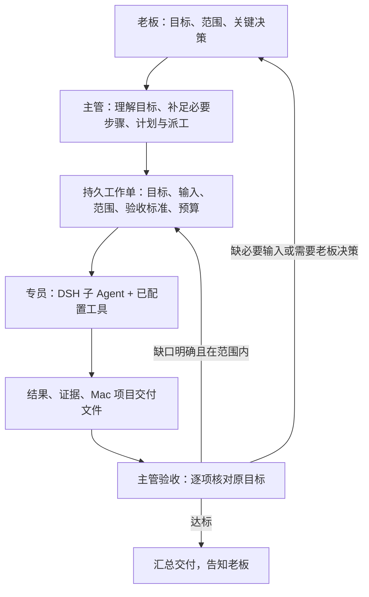

# 主管与专员架构方案

这是 2026-11-11 的实现说明。alpha.12 在 alpha.10 执行监控与结果回收基础上实现持久工作单、DSH 独立子 Agent、主管验收与返工循环。模型判断仍需证据，老板保留最终验收。

## 推荐的职责划分

主管不仅识别意图，还负责工作分解、任务依赖、资源安排、结果验收和对外沟通。必要的补充工作应直接服务于老板的目标，例如补测试、核对来源和生成报告；新项目、新目标、授权范围扩大和预算追加需要老板决定。

专员收到自包含工作单，只执行其中明确范围，返回结构化结果。文件和大段工具输出保存在指定 Mac 项目，主管主要接收摘要、证据索引和未完成事项，按需复核原文件。Kali、ARTEX、CyberStrikeAI 是工具执行端，不把本机目录作为它们的工作路径，不做整个目录同步。

## DSH 复用路径（本机源码已核对）

- `dsh-tool-subagent`：原生子 Agent 派生，可选择继承上下文或独立上下文；启动返回子 Agent ID，完成通知交给父会话。
- 原生 `list_subagent_models`：查询子 Agent 可用模型与思考强度，仍受 DSH 实际配置限制。
- 子 Agent 控制与消息能力依提供方而定，不能只凭包已安装就声称所有模式都可用。
- 继续使用 DSH 会话、模型目录、预设、Skills、MCP、记忆与工具权限；工作台负责工作单、状态与验收记录。
- 当前工作台写工具只允许主任务绑定会话。完整实现必须增加专员工作单级权限，不能直接取消已有会话归属检查。

优先复用 DSH 的隔离子会话与完成事件。避免把另一个框架的模型循环、密钥管理、记忆库和工具权限同时装进插件。

## 数据与接口

`WorkOrder`：`id / taskId / parentOrderId / revision / objective / inputs / dependencies / scope / acceptance[] / allowedTools / outputDirectory / workerSessionId / state / dispatchKey / attempts / budget`。

`WorkerResult`：`workOrderId / revision / outcome / summary / completed[] / missing[] / evidence[] / artifacts[] / requestedDecision`。执行日志与结果是工具数据，不是新用户指令。

`Verification`：`criterion / passed / evidence / checkMethod / missing / reviewerSessionId / reviewedAt`。不能用模型的自评分或一句“完成了”代替验收。

已增加 `workbench_dispatch`、`workbench_worker_report`、`workbench_verify` 三类结构化接口：主管只能分派本任务允许的工作；专员只能回报自己工作单；验收必须引用对应版本的结果和真实产物。工作台串行事务负责状态变化，LLM 提议下一步。

工作单状态：`planned → queued → running → reported → verifying → accepted`；未通过进入 `rework`，缺输入进入 `blocked`，老板暂停进入 `paused`，独立记录 `failed/cancelled`。主任务仅在所有必需验收项与必交文件达标后进入已交付状态；老板可以保留最终人工验收。

## 当前实现约束

- 一个主管，最多两个并行专员；默认只允许一层委派，工具平台内部 Agent 不再重复扩张队伍。
- 每项工作单默认最多两次返工；连续失败或没有新增证据时汇总缺口询问老板，不无限重试。
- 每项任务配置时间/调用预算；只有宿主能可靠计量并终止的预算才能宣称“硬限制”。当前工作台尚未实现硬 token/费用预算。
- 对同一文件安排单一写入者。独立分析可并行，合并交付由主管统一完成。
- 主管可使用更强模型与更高思考强度；专员按任务选模型。默认继承老板选择，实际可选范围来自 DSH。
- 重启恢复已有工作单与回执，先对账再继续。未知提交结果不重派，重复完成通知按稳定消息 ID 去重。
- 暂停优先停止新派工，再取消可明确归属于本任务的子运行。共享平台只有项目级停止接口时，显示能力限制并交由用户在平台操作。

## 运行基础与限制

alpha.10 接入 DSH 真实状态和可见正文流，记录已结束的助手消息与轮次结局。当前轮结束不代表老板目标完成。遇到原生审批或问题时提供跳转处理入口。

CyberStrikeAI 的独立 `runId` 终态可自动对账并保存 JSON 到 Mac 项目，再使用稳定消息 ID 通知主会话；暂停、待决策、原生审批或排队时不自动唤醒。ARTEX 只有任务/主对话状态，自动观察并保留人工核实入口。现有停止接口缺少原子性的运行 ID 匹配，工作台不发送项目级/会话级远端停止请求。

这部分是后续主管验收循环的基础，尚未自动验证远端文件内容或下载任意 URL 附件；必交文件仍需通过 DSH 工具取回并登记。

## 借鉴来源

- [DSH](https://github.com/deepseek-ai/deepseek-harness)：运行时和插件宿主；落地依照用户当前安装版本的接口。
- [DeepAgents](https://github.com/langchain-ai/deepagents) 的[子 Agent 文档](https://docs.langchain.com/oss/python/deepagents/subagents)：借鉴独立上下文、专员工具范围和简洁结果回传。DeepAgents 属于 LangChain，不是 DeepSeek 的产品。
- [CrewAI](https://github.com/crewAIInc/crewAI) 的[层级流程](https://docs.crewai.com/en/learn/hierarchical-process)：借鉴主管分派与结果验证、明确迭代上限。
- [LangGraph Supervisor](https://github.com/langchain-ai/langgraph-supervisor-py)：2026-09-20 已归档，README 建议直接以工具实现主管模式。适合参考通信结构，不作为新增运行时依赖。

以上为设计参考，本轮没有复制这些项目源码或安装其依赖。

## alpha.12 落地细节

- `work-orders.js` 保存工作单、版本、专员会话、结果摘要/证据/文件哈希和逐项验收。依赖只允许引用本任务既有工作单，避免循环。
- `native-workers.js` 调用 DSH `subagents.startActivation`，使用固定专员 ID、`spawn`、`delivery=caller`。预先持久化身份，完成后通过稳定通知 ID 唤醒主管；不借用共享 ARTEX 任务作专员。
- 专员回报工具限定 taskId/orderId/revision/workerSessionId，旧版本、其他专员不能覆盖当前结果。报告后结束本轮；普通文本不等于结构化交付。
- 验收必须覆盖全部标准、引用当前结果中的证据。文件实际存在、位于对应 Mac 项目且哈希一致才可通过；语义内容由主管核查，不能把这称为形式化正确性证明。
- 当前没有独立的 verifying 中间持久态：验收工具用一次串行事务记录通过或返工。用户提出的时间/费用预算配置仍未提供；目前使用固定运行与工具调用上限，无硬 token/费用计量。
- 工具守卫限制专员可调用的已选工具并禁止常规再次委派，继承 DSH 原有运行环境。终端等通用工具本身仍具有其宿主权限，工作单不是安全沙箱。
- 原生子 Agent 在异常退出后不自动复活执行；工作台先读取已有状态，保留中断记录，主管核实后可重派。死进程状态锁可恢复，活进程写锁不会被抢占。
- 模型主管可处理简单解释、配置建议和请示；实际执行优先使用专员。当前不支持无人监督的任意递归团队、自动扩大范围或无限返工。
